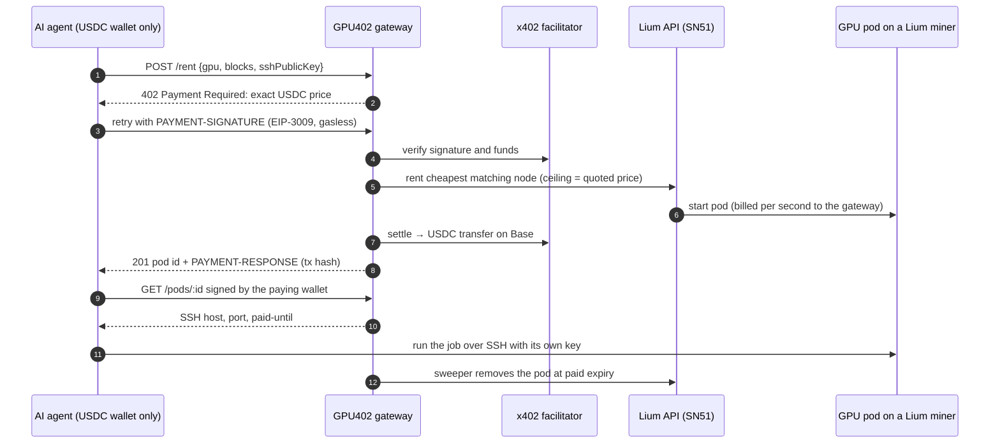

<div align="center">

# GPU402

### Rent a decentralized GPU in one call. Let AI agents pay for it themselves.

**TypeScript SDK and x402 payment gateway for [Lium](https://lium.io), the GPU marketplace on Bittensor Subnet 51**

[](https://github.com/GPU402/gpu402/actions/workflows/ci.yml)
[](LICENSE)
[](https://lium.io)
[](https://github.com/coinbase/x402)
[](tsconfig.base.json)

[Quick start](#quick-start) · [How it works](#how-a-paid-rental-works) · [SDK](#the-sdk) · [Agent tools](#agent-tools) · [Gateway API](#gateway-api) · [Security](#security-model) · [Demo](DEMO.md)

</div>

---

```ts
const pod = await lium.rentCheapest({ gpu: "RTX4090", maxUsdPerHour: 0.5, ttlMinutes: 30, sshPublicKey });
const out = await lium.exec(await lium.waitReady(pod.podId), "nvidia-smi && python train.py", { privateKey });
await lium.stop(pod.podId);
```

> An AI agent holding nothing but a USDC wallet calls `POST /rent`, gets an **HTTP 402** quote, signs a payment, and has SSH on a GPU served by a Bittensor miner a minute later. It needs no account, no API key and no gas. When the paid time runs out, the pod is removed automatically.

## Why

[Lium](https://lium.io) is a GPU marketplace on Bittensor Subnet 51: NVIDIA GPUs from independent providers, billed per second. Two large groups of buyers struggle to use it today:

| Today | With GPU402 |
|---|---|
| TypeScript developers get an OpenAPI spec and generate **types only**. Every request, retry, poll, SSH session and cleanup is theirs to write. | `npm install gpu402`: a typed client generated from Lium's spec, with workflows for rent, wait, run, stop and budget. |
| AI agents need **an account, a key and a card** before they can rent anything. | Agents pay **per 15-minute block in USDC over x402**, from a wallet, with no signup. |
| Running a job means rebuilding **SSH execution** yourself. | `exec()` and `runOnGpu` stream output and return the exit code. |

Every one of these is GPU demand that goes to centralized clouds instead of Lium's miners. GPU402 sends it to SN51.

## What's inside

| | Package | What it does |
|---|---|---|
| 🧰 | [`gpu402`](packages/sdk) | Typed TypeScript SDK for Lium, generated from its OpenAPI 3.1 spec, with `rentCheapest`, `waitReady`, `exec`, `stop`, a budget guard, typed errors and retries |
| 💸 | [`apps/gateway`](apps/gateway) | x402 gateway: sells Lium GPU time in prepaid 15-minute blocks for USDC on Base, rents on its own Lium account, removes pods at expiry |
| 🤖 | [`@gpu402/tools`](packages/tools) | `rentGpu`, `runOnGpu`, `stopGpu` and `listGpus` for the **Vercel AI SDK** and **LangChain.js**, in key mode or x402 mode |
| 📊 | [`apps/dashboard`](apps/dashboard) | Live view: rentals with countdowns, payments with BaseScan links, GPU-minutes routed to Lium, SN51 stats read from chain |

Nothing is simulated. Prices come from Lium's live market and pods run on real SN51 nodes. Payments settle in USDC on Base Sepolia through the public x402 facilitator. Subnet stats are read straight from Bittensor Finney.

## How a paid rental works



### Guarantees

- **You pay only for a GPU you got.**
  - The gateway rents on Lium after the payment is *verified* but before it *settles*. If Lium can't rent, x402 never settles.
  - If settlement fails, the pod is removed at once.
  - If a paid pod never starts, it's removed and the USDC is refunded on-chain. If Lium loses a running pod, the unused time is refunded.
- **No cost ever leaks.**
  - Every pod carries a Lium-side removal schedule, so Lium deletes it even if the gateway is down.
  - A sweeper removes pods at their paid expiry.
  - On startup, the gateway removes any pods it lost track of in a crash.
  - It refuses to quote a rent its own Lium balance can't cover under Lium's 15-minute balance rule.
- **The price you see is the price you pay.** A quote is locked for 5 minutes. The rent's Lium price ceiling is that quote, so the gateway never pays Lium more than the agent was charged for.
- **Paid time starts when the pod answers SSH**, not when the rent is accepted.
- **The gateway never holds a private key.** Agents bring an SSH public key, and pod access is proven with an EIP-191 signature from the paying wallet.

**Pricing:** one block costs the Lium hourly price × 0.25 × (1 + margin), computed in integer micro-USDC and rounded up. The margin is 10% by default and set in config.

## Quick start

Requires Node 22.5+ and pnpm.

```bash
git clone https://github.com/GPU402/gpu402.git && cd gpu402
pnpm install
pnpm build
pnpm test
```

### Run the live demo

```bash
pnpm setup:wallets     # writes .env with a fresh gateway wallet and agent wallet (Base Sepolia)
```

Fill in `.env`:

| Variable | Where to get it |
|---|---|
| `LIUM_API_KEY` | [lium.io](https://lium.io) → Access → API Keys (scopes `read`, `rent`, `manage`) |
| Agent USDC | [faucet.circle.com](https://faucet.circle.com) → Base Sepolia → the agent address printed above |
| `GOOGLE_GENERATIVE_AI_API_KEY` | [aistudio.google.com/apikey](https://aistudio.google.com/apikey) (free tier). Or `ANTHROPIC_API_KEY` with `AGENT_PROVIDER=anthropic` |
| Gateway ETH *(optional)* | A little Base Sepolia ETH on the gateway address, used for gas when refunding on-chain |

```bash
pnpm check:wallets     # pre-flight: balances, Lium key, facilitator; every line should be ✔
pnpm dev               # gateway on :4020 + dashboard on :3000
pnpm demo:agent        # an AI agent rents a GPU over x402, benchmarks it, releases it
pnpm demo:sdk          # the five-line SDK example, on your own Lium key
```

Give the agent any task: `pnpm demo:agent "train a tiny MLP on MNIST and report test accuracy"`. Recording a demo? See [DEMO.md](DEMO.md).

## The SDK

```bash
npm install gpu402
```

```ts
import { Lium, generateSshKeyPair } from "gpu402";

const ssh = generateSshKeyPair();                         // the private key never leaves your process
const lium = new Lium({ apiKey: process.env.LIUM_API_KEY, budgetUsd: 5 });

const gpus = await lium.listGpus({ gpu: ["RTX4090", "RTX3090"], maxUsdPerGpuHour: 0.6 });
const pod = await lium.rentCheapest({ gpu: "RTX4090", ttlMinutes: 30, sshPublicKey: ssh.publicKey });
const ready = await lium.waitReady(pod.podId, { onProgress: (p) => console.log(p.status) });
const run = await lium.exec(ready, "python train.py", { privateKey: ssh.privateKey, onStdout: process.stdout.write.bind(process.stdout) });
await lium.stop(pod.podId);
```

| Method | Lium API | Adds |
|---|---|---|
| `listGpus(filter)` | `GET /executors` | Filter by model(s), price, VRAM, country, reliability; cheapest first |
| `quote(node, {minutes})` | `GET /executors/{id}/quote` | Per-hour, per-block and total price; balance floor |
| `rent(node, opts)` | `POST /executors/{id}/rent` | Idempotency key, official PyTorch template matched to the node's CUDA version, server-side TTL |
| `rentCheapest(spec)` | list, then rent | Falls through to the next cheapest node (across all allowed models) if one is taken |
| `rentBySpec(spec)` | `POST /executors/rent-by-spec` | Lium's server-side pick, with `dryRun` |
| `waitReady(podId)` | `GET /pods/{id}` | Polls until RUNNING with SSH reachable; typed error on a terminal status or timeout |
| `exec(pod, cmd, opts)` | SSH | Streams stdout and stderr; exit code, timeout, output cap |
| `stop(podId)` | `DELETE /pods/{id}` | Idempotent; returns what Lium actually billed |
| `budget(usd)`, `watchBudget()` | local + ledger | Refuses rents whose worst case is over the cap; stops pods when the cap is reached |
| `api` | all 210 paths | Fully typed raw client generated from Lium's spec (`pnpm gen:types`) |

Errors map Lium's `error.code` to typed classes: `LiumInsufficientBalanceError`, `LiumNoMatchError` (with `.constraint`), `LiumRateLimitError`, `PodStartError`, `BudgetExceededError` and more. Retries back off with jitter on 429 and 5xx and honour `Retry-After`. A POST is retried only when it carries an `Idempotency-Key`.

## Agent tools

```bash
npm install @gpu402/tools ai
```

```ts
import { createGpuTools } from "@gpu402/tools/ai";
import { generateText, stepCountIs } from "ai";

const { tools, toolkit } = createGpuTools({
  mode: "x402",                                   // or "key", with your Lium API key
  gatewayUrl: "https://your-gateway.example",
  wallet: process.env.AGENT_PRIVATE_KEY as `0x${string}`,
  maxUsdPerPayment: 1,                            // the agent refuses any single payment above $1
});

try {
  const { text } = await generateText({ model, tools, stopWhen: stepCountIs(12), prompt: "Benchmark fp16 matmul TFLOPS on an RTX 4090" });
} finally {
  await toolkit.stopAll();                        // never leave a GPU running
}
```

LangChain.js: `import { createGpuTools } from "@gpu402/tools/langchain"` returns `DynamicStructuredTool` instances. See [the full example](examples/agent-demo/src/langchain-agent.ts).

## Gateway API

| Endpoint | Paid | Behaviour |
|---|---|---|
| `GET /gpus` | free | Live Lium GPU models with GPU402 block prices |
| `GET /quote?gpu=&blocks=&gpuCount=` | free | Exact price of a rent, locked for 5 minutes |
| `POST /rent` | **x402** | `{gpu, gpuCount?, blocks?, sshPublicKey, maxUsdPerGpuHour?}` → pod id, settlement tx |
| `POST /pods/:id/extend` | **x402** | `{blocks}`: more time at the pod's locked block price |
| `GET /pods/:id` | signed | Status, SSH endpoint and time left. Send `X-GPU402-Timestamp` and `X-GPU402-Signature`: the paying wallet's signature over `ownershipMessage(podId, ts)` |
| `DELETE /pods/:id` | signed | Stop early |
| `GET /api/state`, `/api/events` (SSE), `/api/sn51`, `/api/lium` | free | Dashboard feed |

The gateway is a Hono app on Node with `@x402/hono` and a `node:sqlite` ledger (no native build step). Run it as a container:

```bash
docker build -f apps/gateway/Dockerfile -t gpu402-gateway .
docker run --env-file .env -p 4020:4020 -v gpu402-data:/app/apps/gateway/data gpu402-gateway
```

It's mainnet-ready and runs on testnet by default. Every network is a CAIP-2 identifier: to go live, set `X402_NETWORK=eip155:8453` (Base), point `FACILITATOR_URL` at a mainnet facilitator and fund the gateway's Lium account.

## Security model

- **The API key comes only from you.** The SDK reads it from `new Lium({ apiKey })` or `LIUM_API_KEY`. It sends it only as the `X-API-Key` header to the Lium API (`https://lium.io/api` unless you set `baseUrl`). It never logs it.
- **No telemetry.** The SDK makes no network calls other than the ones you ask for. Its runtime dependencies are `openapi-fetch` and `ssh2`.
- **The gateway never touches private keys.** Pods are reached with the agent's own SSH key, and payments are signed in the agent's process.
- **Pod access is bound to the payer.** An ownership proof is signed by the paying wallet, tied to one pod id, and valid for 5 minutes.
- **Abuse limits.** Paid and signed routes are rate-limited per client, request bodies are capped at 16 KiB, and security headers are set. Agents cap their own spend per payment.

Found a vulnerability? Please open a private security advisory on this repository.

## Testing

```bash
pnpm test        # build first: pnpm build
```

- **Real SSH.** SSH tests run over a real connection to a local `ssh2` server: streaming, exit codes, safe quoting, rejection of an unauthorized key, timeouts and output caps.
- **Real payment signatures.** Gateway tests drive the full paid loop with EIP-3009 signatures from `@x402/fetch`. A test facilitator cryptographically verifies every signature, and a server that speaks Lium's wire format makes every Lium outcome reproducible.
- **Failure paths:**
  - no charge when Lium can't rent, and immediate removal when settlement fails;
  - full refund for a pod that never starts, and a pro-rata refund when one is lost;
  - crash recovery, and orphan reconciliation on startup;
  - signature-bound pod access, rate limits and size limits.
- **The whole agent chain.** One test runs AI-SDK tools in x402 mode → gateway → pod → `runOnGpu` over SSH → `stopGpu`.
- **Live reads.** Read-only tests call the live Lium API (market, quotes, templates). Set `GPU402_OFFLINE=1` to skip them.

CI runs build, typecheck, tests and the dashboard build on every push.

## Repository layout

```
packages/sdk        gpu402: typed Lium client, SSH exec, budget guard, gateway protocol types
packages/tools      @gpu402/tools: x402 gateway client + Vercel AI SDK and LangChain.js tools
apps/gateway        x402 gateway: pricing, ledger, sweeper, refunds, SN51 chain reader, Dockerfile
apps/dashboard      Next.js live dashboard
examples/           agent-demo (AI SDK + LangChain.js), sdk-quickstart
scripts/            setup-wallets, check-wallets
```

## Roadmap

- **Hosted gateway** with spend caps per agent, team wallets and usage reports.
- **More Bittensor services over x402.** The same gateway pattern can sell inference on Chutes (SN64) and storage on Hippius (SN75), making GPU402 a pay-per-use rail for Bittensor services.
- **Mainnet**, with Lium's agreement on resale terms.

## Built on

[Lium API](https://lium.io/api/openapi.json) (the source of truth: SDK types are regenerated from its spec) · [Lium docs](https://docs.lium.io) · [x402](https://github.com/coinbase/x402) `@x402/*` v2 · [Bittensor subtensor](https://github.com/opentensor/subtensor) via polkadot.js · [Hono](https://hono.dev) · [Next.js](https://nextjs.org) · [viem](https://viem.sh)

Built for Bittensor Builders House, Track 4 (Build on a Subnet), 2026. GPU402 is a community project and isn't maintained by Lium.

## License

[MIT](LICENSE) © [rythmern02](https://github.com/rythmern02)
