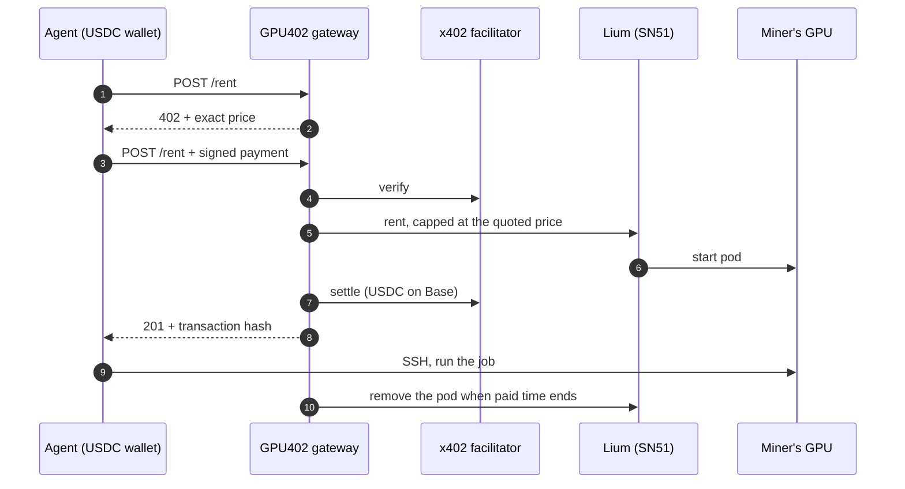

<div align="center">

<h1>GPU402</h1>

<p><strong>Decentralized GPUs for any TypeScript program, paid for by the request.</strong></p>

<p>
<a href="https://github.com/GPU402/gpu402/actions/workflows/ci.yml"></a>
<a href="LICENSE"></a>
<a href="https://lium.io"></a>
<a href="https://github.com/coinbase/x402"></a>
</p>

</div>

<br>

HTTP status 402, *Payment Required*, has been "reserved for future use" since 1997. GPU402 puts it to work.

An AI agent asks for a GPU. The server answers `402` with a price. The agent signs a USDC payment from its own wallet and asks again. Its answer is a pod on [Lium](https://lium.io), the GPU marketplace that runs on Bittensor Subnet 51, with SSH ready. When the time it paid for runs out, the pod is gone. Nobody opened an account, and nobody typed a credit card number.

For developers who would rather hold a Lium API key themselves, the same machinery comes as a typed TypeScript SDK. Five lines rent the cheapest matching GPU on the network, run a job and give it back.

```ts
import { Lium, generateSshKeyPair } from "gpu402";

const ssh  = generateSshKeyPair();
const lium = new Lium({ apiKey: process.env.LIUM_API_KEY });

const pod = await lium.rentCheapest({ gpu: "RTX4090", maxUsdPerHour: 0.5, ttlMinutes: 30, sshPublicKey: ssh.publicKey });
const run = await lium.exec(await lium.waitReady(pod.podId), "nvidia-smi && python train.py", { privateKey: ssh.privateKey });
await lium.stop(pod.podId);
```

<br>

## One request, end to end

This is the whole protocol as an agent sees it: two HTTP calls to rent, and one signed call to read the SSH details. The prices are real Lium prices; the IDs, hosts and hashes below are placeholders.

```http
POST /rent
Content-Type: application/json

{ "gpu": "RTX 4090", "blocks": 1, "sshPublicKey": "ssh-ed25519 AAAAC3Nz… agent" }
```

```http
HTTP/1.1 402 Payment Required
PAYMENT-REQUIRED: eyJ4NDAyVmVyc2lvbiI6Miwi…

{ "error": "payment_required",
  "message": "1 block(s) of NVIDIA GeForce RTX 4090 (15 min) cost $0.096250 USDC. Retry with a signed x402 payment." }
```

The agent's wallet signs an EIP-3009 `transferWithAuthorization` for exactly 0.096250 USDC. That's a signature, not a transaction, so the agent needs no gas. It sends the same request again with the signature attached:

```http
HTTP/1.1 201 Created
PAYMENT-RESPONSE: eyJzdWNjZXNzIjp0cnVlLCJ0cmFuc2FjdGlvbiI6IjB4…

{ "podId": "8c1f…", "status": "starting", "gpu": "NVIDIA GeForce RTX 4090", "blocksPaid": 1,
  "payments": [{ "amountUsd": 0.09625, "explorerUrl": "https://sepolia.basescan.org/tx/0x…" }] }
```

A minute later, `GET /pods/8c1f…`, signed by the same wallet, returns `ssh root@<host> -p <port>`. The agent connects with a key that never left its process.

With the [agent tools](#agent-tools), all of this is one function call the model decides to make.

<br>

## What is in the box

**`gpu402`** · [packages/sdk](packages/sdk)
A TypeScript client for Lium's REST API. Its types are generated from Lium's own OpenAPI spec, so when Lium's API changes, regenerating keeps the SDK in step. On top of the raw client it handles what every integrator ends up writing anyway: picking the cheapest node, falling through to the next one when a node is taken, waiting for the pod to boot, running commands over SSH, cleaning up, and keeping spend under a cap.

**The x402 gateway** · [apps/gateway](apps/gateway)
A small HTTP service that sells Lium GPU time in prepaid 15-minute blocks. It holds one Lium account, quotes in USDC, accepts payment over x402, and rents for whoever paid. Run it locally for development, or in a container in production.

**`@gpu402/tools`** · [packages/tools](packages/tools)
`rentGpu`, `runOnGpu`, `stopGpu` and `listGpus`, ready to hand to the Vercel AI SDK or LangChain.js. One flag switches them between your Lium key and an agent paying from its wallet.

**The dashboard** · [apps/dashboard](apps/dashboard)
A live view for operators and anyone watching the demo: pods counting down, every payment linked to its BaseScan transaction, the GPU market, and Subnet 51 read straight from the Bittensor chain.

<br>

## How a paid rental works



<br>

## Decisions worth knowing about

**Rent first, settle second.** The x402 middleware verifies a payment before the request reaches the handler, and settles only if the handler succeeds. GPU402 rents the pod in that gap. If Lium can't rent, the request fails and the payment is never settled, so nobody pays. If settlement fails after the rent, the pod is removed on the spot. And if a paid pod never boots, the gateway removes it and sends the USDC back on-chain.

**Two clocks, both counting down.** Each pod is removed twice over: once by the gateway's sweeper at the paid expiry, and once by a removal Lium schedules on its own servers a few minutes later. If the gateway crashes, Lium still cleans up. When the gateway restarts, it also removes any of its pods it no longer has a record of.

**Prices that hold still.** A quote is fixed for five minutes, so the 402 an agent sees is exactly what it is charged when it pays. The rent then goes to Lium with that same price as a ceiling, so the gateway can never lose money on a node whose price rose in between. Amounts are computed in integer micro-USDC and rounded up.

**Paid time starts at SSH, not at signature.** The agent's 15 minutes begin when the pod actually answers on its SSH port. Boot time is the gateway's cost, not the agent's.

**Keys stay where they were born.** Agents bring an SSH public key and keep the private half. Payments are signed in the agent's process. To read a pod's SSH details, the agent proves it is the wallet that paid, with an EIP-191 signature tied to that one pod and valid for five minutes. The gateway holds only its own Lium key.

**No money in, no 402 out.** Before quoting, the gateway checks that its Lium balance covers Lium's 15-minute rule for every running pod plus the new one. If it can't fund the rent, it says so and never asks for payment.

<br>

## Getting started

You need Node 22.5 or later and pnpm.

```bash
git clone https://github.com/GPU402/gpu402.git
cd gpu402
pnpm install && pnpm build && pnpm test
```

To watch an agent pay for a GPU, you need four things in `.env`: a Lium API key, some test USDC, a model key, and two wallets. The last one is generated for you.

```bash
pnpm setup:wallets     # creates .env with a gateway wallet and an agent wallet on Base Sepolia
```

| In `.env` | Where it comes from |
|---|---|
| `LIUM_API_KEY` | lium.io → Access → API Keys, with `read`, `rent` and `manage` |
| USDC for the agent | [faucet.circle.com](https://faucet.circle.com), Base Sepolia, to the agent address printed above |
| `GOOGLE_GENERATIVE_AI_API_KEY` | [aistudio.google.com/apikey](https://aistudio.google.com/apikey). Or set `AGENT_PROVIDER=anthropic` and `ANTHROPIC_API_KEY` |
| Gas for refunds, optional | A little Base Sepolia ETH on the gateway address |

```bash
pnpm check:wallets     # every line should read ✔
pnpm dev               # gateway on :4020, dashboard on :3000
pnpm demo:agent        # an agent rents a GPU, benchmarks it, and gives it back
```

The agent takes any task you hand it, such as `pnpm demo:agent "fine-tune a tiny MLP on MNIST and report accuracy"`. For recording a demo, see [DEMO.md](DEMO.md).

<br>

## The SDK

```bash
npm install gpu402
```

| Call | Under the hood | What it saves you |
|---|---|---|
| `listGpus(filter)` | `GET /executors` | Filtering by model, price, VRAM, country and reliability, sorted cheapest first |
| `quote(node)` | `GET /executors/{id}/quote` | Price per hour, per 15-minute block, and the balance Lium requires |
| `rentCheapest(spec)` | list, then `POST /executors/{id}/rent` | Moving to the next node when one is taken, across every model you allow |
| `rent(node, opts)` | `POST /executors/{id}/rent` | Idempotency keys, picking the right PyTorch image for the node's CUDA version, a TTL set on Lium's side |
| `rentBySpec(spec)` | `POST /executors/rent-by-spec` | Lium's own matcher, with a dry-run mode |
| `waitReady(id)` | `GET /pods/{id}` | Polling, detecting dead pods, probing the SSH port, timeouts |
| `exec(pod, cmd)` | SSH | Streamed stdout and stderr, exit codes, timeouts, output caps |
| `stop(id)` | `DELETE /pods/{id}` | Safe to call twice; returns what Lium actually billed |
| `budget(usd)` | local | Refusing any rent whose worst case would pass the cap, and stopping pods when it's reached |
| `api` | every endpoint | A fully typed raw client for all 210 paths |

Failures come back as typed errors built from Lium's own error codes, such as `LiumInsufficientBalanceError`, `LiumNoMatchError` (which says which filter ruled everything out) and `PodStartError`. Rate limits and server errors are retried with backoff. A rent is retried only when it carries an idempotency key, so a retry can never rent twice.

<br>

## Agent tools

```bash
npm install @gpu402/tools ai
```

```ts
import { createGpuTools } from "@gpu402/tools/ai";
import { generateText, stepCountIs } from "ai";

const { tools, toolkit } = createGpuTools({
  mode: "x402",                                    // or "key", with a Lium API key
  gatewayUrl: process.env.GPU402_GATEWAY_URL,
  wallet: process.env.AGENT_PRIVATE_KEY as `0x${string}`,
  maxUsdPerPayment: 1,
});

try {
  await generateText({ model, tools, stopWhen: stepCountIs(12), prompt: "How many fp16 TFLOPS does an RTX 4090 really give you?" });
} finally {
  await toolkit.stopAll();
}
```

The LangChain.js version lives at `@gpu402/tools/langchain` and returns `DynamicStructuredTool` instances; see the [example](examples/agent-demo/src/langchain-agent.ts). Each toolkit generates its own SSH key pair in memory, and the agent refuses any single payment above `maxUsdPerPayment`.

<br>

## Gateway reference

| Route | Access | |
|---|---|---|
| `GET /gpus` | open | Every rentable model with its GPU402 block price |
| `GET /quote` | open | `?gpu=&blocks=&gpuCount=` → the exact price, held for five minutes |
| `POST /rent` | x402 | `{ gpu, gpuCount?, blocks?, sshPublicKey, maxUsdPerGpuHour? }` |
| `POST /pods/:id/extend` | x402 | `{ blocks }`, at the pod's original block price |
| `GET /pods/:id` | wallet signature | Status, SSH endpoint and time remaining |
| `DELETE /pods/:id` | wallet signature | Ends the rental early |
| `GET /api/events` | open | Server-sent events, the feed behind the dashboard |

Ownership is proven with two headers, `X-GPU402-Timestamp` and `X-GPU402-Signature`. The second is the paying wallet's signature over `ownershipMessage(podId, timestamp)`, exported from `gpu402`.

### Running it

```bash
docker build -f apps/gateway/Dockerfile -t gpu402-gateway .
docker run --env-file .env -p 4020:4020 -v gpu402-data:/app/apps/gateway/data gpu402-gateway
```

| Setting | Default | |
|---|---|---|
| `X402_NETWORK` | `eip155:84532` | Base Sepolia. `eip155:8453` is Base mainnet |
| `FACILITATOR_URL` | `https://x402.org/facilitator` | Use a mainnet facilitator for real funds |
| `MARGIN` | `0.10` | Block price = Lium hourly × 0.25 × (1 + margin) |
| `MAX_BLOCK_PRICE_USD` | `1` | Never sell a block above this |
| `MAX_ACTIVE_PODS` | `5` | Concurrency ceiling for the gateway's Lium account |
| `RESERVE_USD` | `0.5` | Balance kept on top of Lium's 15-minute rule |
| `START_TIMEOUT_MIN` | `12` | A pod not up by then is removed and refunded |
| `REFUND_PRIVATE_KEY` | unset | The pay-to wallet's key; turns on on-chain refunds |
| `ALLOWED_GPUS` | all | Limit what you sell, e.g. `RTX 4090,RTX 3090` |

Going from testnet to mainnet is a configuration change: switch the network, the facilitator, and the account that funds the rentals.

<br>

## Security

The SDK reads your API key from the constructor or from `LIUM_API_KEY`, and from nowhere else. It sends the key only to the Lium API, as the `X-API-Key` header, and never logs it. There is no telemetry: the SDK makes no requests you didn't ask for, and its only runtime dependencies are `openapi-fetch` and `ssh2`.

The gateway rate-limits its paid and signed routes per client, caps request bodies at 16 KiB, and sends standard security headers. It never sees an agent's private key.

To report a vulnerability, open a private security advisory on this repository.

<br>

## Tests

`pnpm test` runs the SDK, tools and gateway suites. They exercise the real thing wherever a test can:

- **SSH:** commands run over a genuine SSH connection to a local server.
- **Payments:** every payment carries a real EIP-3009 signature, made by the same x402 client agents use and checked cryptographically by the test facilitator.
- **Lium:** answers come from a server speaking Lium's exact wire format, so the cases that are hard to catch live can be forced: a node taken mid-rent, a pod that never boots, a gateway that crashes between renting and settling.
- **The whole agent:** one test runs it from the first `402` to the last `DELETE`, with a real command executed on the pod in between.
- **Live market:** a handful of read-only tests query Lium's live market. `GPU402_OFFLINE=1` skips them.

CI runs build, typecheck, tests and the dashboard build on every push.

<br>

## Repository

```
packages/sdk       gpu402: the Lium client
packages/tools     @gpu402/tools: AI SDK and LangChain.js tools, gateway client
apps/gateway       the x402 gateway
apps/dashboard     the live dashboard
examples           an x402 agent, a LangChain.js agent, the five-line quickstart
scripts            wallet setup and pre-flight checks
```

<br>

## Where it goes next

The gateway pattern isn't specific to GPUs. Anything on Bittensor that has an API and a price can sit behind a 402. Inference on Chutes (SN64) and storage on Hippius (SN75) are the obvious next two. Before that come a hosted gateway with per-agent spend caps and team wallets, and a mainnet launch once Lium has agreed the resale terms.

<br>

---

<sub>Built for Bittensor Builders House, Track 4, 2026. GPU402 is an independent community project and is not maintained by Lium. MIT licensed. Made by <a href="https://github.com/rythmern02">rythmern02</a>.</sub>
